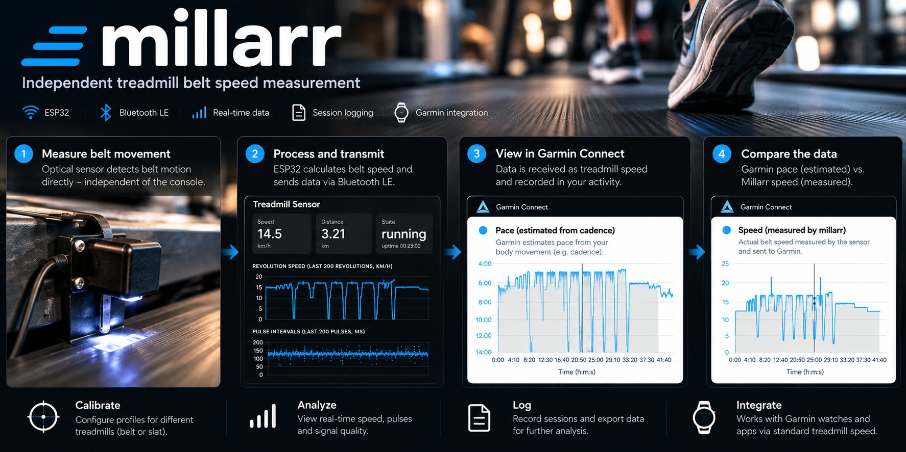

# millarr

[](https://github.com/KnutEdmund/millarr/actions/workflows/ci.yml)

**Treadmill belt speed sensor.** Measure the belt, not the console.



*Concept illustration. The values in it are not measurements; the Garmin charts
below are real data from a field run.*

millarr is a self-powered ESP32 sensor that measures the **actual belt movement**
of a treadmill with an IR reflective sensor and a mark on the belt. It broadcasts
belt speed over Bluetooth LE as a foot pod, so a Garmin watch records the real
belt speed in the activity. It sends speed only: the standard BLE profile has a
cadence field, but millarr leaves it at 0 and cadence stays with the watch or
heart-rate strap.

## Why

A treadmill console may report the commanded speed rather than an independently
measured belt speed, and calibration drifts from machine to machine. The watch's
own pace on a treadmill is an estimate from arm and foot motion. millarr gives an
independent measurement: every belt revolution is timed, recorded and available
for analysis afterwards.

The same interval session in Garmin Connect, as the watch estimated it and as
millarr measured it:

| Pace, estimated by the watch and strap | Speed, measured by millarr |
|---|---|
|  |  |

## What it does

The device timestamps every mark pulse to the microsecond, computes revolution-based
speed with per-mark distance correction, hosts its own Wi-Fi access point, and serves
a diagnostic web page with live speed, per-mark statistics, sensor signal capture and
CSV export, and keeps every session as a CSV file on its own flash so long runs are
captured without a browser connected. Per-treadmill profiles (name, mark count,
measured mark distances, or slat count and pitch for slat belts) and the Wi-Fi
access point credentials are configured from a **Settings** page and persisted in
NVS across power cycles.

**Status:** under active development (`v0.1.0`). Verified on one slat treadmill
with a Garmin Instinct 2. Precision and repeatability are established in field
runs; absolute accuracy depends on the belt length entered in the profile and is
still being validated against an independent measurement.

## Hardware

- ESP32 dev board (38-pin, CP2102, USB-C)
- TCRT5000 IR reflective sensor module (DO → GPIO18, AO → GPIO34)
- WeMos 18650 battery shield V3 + 18650 cell
- One to eight white marks on the belt. All field runs so far use a single strip
  of white tape; the firmware's first-boot default is three equidistant marks.
  Slat belts work the same way; their length is entered as slat count × pitch,
  never measured with a tape

See `docs/hardware.md` for wiring and belt marking.

## Build and flash

Requires [PlatformIO Core](https://platformio.org/) (`brew install platformio`).

```bash
pio test -e native            # unit tests for the speed engine, on your computer
pio run -e esp32dev           # build firmware
pio run -e esp32dev -t upload # flash (port is auto-detected)
pio device monitor            # serial status line, 115200 baud
```

If auto-detection picks the wrong port, pass it explicitly with
`--upload-port /dev/cu.usbserial-XXXX` (and `--port` for the monitor), or set
`PLATFORMIO_UPLOAD_PORT` in your shell.

## Use

1. Power the sensor. It starts a Wi-Fi network `treadmill-sensor` (password in
   `include/config.h`, change it under **Settings**). The web interface is plain
   HTTP on the sensor's own access point, with no login; anyone who knows the
   Wi-Fi password can change settings.
2. Connect a phone or laptop to that network. The sensor acts as a captive
   portal, so the phone's network sign-in sheet opens the dashboard by itself. To
   open it in a full browser (needed for CSV downloads on a phone), go to
   `http://192.168.4.1/` (or `http://treadmill.local/`) **with the `http://`
   prefix typed explicitly**; browsers otherwise try HTTPS, which the sensor does
   not serve.
3. Open **Settings** to create a profile per treadmill — up to 20 — with a name,
   optional notes (location, model, quirks), marks, and the measured distance
   between marks; a "+ New profile" button on both pages jumps straight to a blank
   profile form. Also change the sensor's Wi-Fi name and password here. The active
   profile survives power cycles. Settings also lets you download all profiles as
   a JSON backup and restore them onto the same or another sensor.
4. Follow `docs/test-protocol.md` to verify the sensor before trusting the numbers.
5. Get the belt speed onto a Garmin watch (`docs/garmin.md`). Two routes:
   - **Connect IQ data field (recommended):** install ExtraSensor from the
     Connect IQ store and let it connect to the sensor from inside the activity.
     Belt speed is recorded as a developer field next to the watch's own pace,
     and an HRM strap keeps running power and dynamics. Verified on the
     Instinct 2.
   - **Native foot pod:** pair the sensor as a Bluetooth foot pod; belt speed
     and distance replace the watch's pace. Simpler, but an HRM 600 must then be
     paired as heart rate only.
6. After a run, download the session file from the Sessions table on the
   diagnostic page. A session starts at boot and at each reset; files carry the
   profile geometry and firmware hash in their header.

## Layout

| Path | What |
|------|------|
| `lib/speed_core/` | Pure C++ speed engine, log, profile model and formatters (unit-tested) |
| `src/` | Firmware: ISR, Wi-Fi AP, HTTP server, ADC probe, `src/profile_store.cpp` (profiles and Wi-Fi settings in NVS), `src/flash_log.cpp` (session files on LittleFS), `src/ble_rsc.cpp` (BLE foot pod via NimBLE) |
| `web/index.html` | Diagnostic page, embedded into firmware at build time |
| `web/settings.html` | Settings page: profile editor and Wi-Fi credentials, embedded at build time |
| `test/` | Unity tests (`pio test -e native`) |
| `docs/` | Hardware, test protocol, HTTP API, design specs and plans |

## Roadmap

- **Milestone 2 (BLE RSC foot pod for Garmin watches):** done. Verified on the
  Instinct 2 both as a native foot pod and through the ExtraSensor data field;
  the data field is the recommended route (`docs/garmin.md`).
- **Milestone 3 (profiles and web configuration):** done.

## License

MIT, see [LICENSE](LICENSE).
