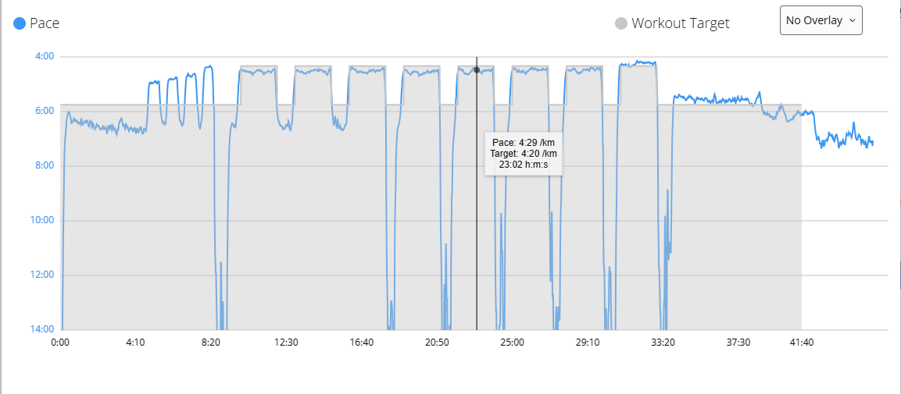
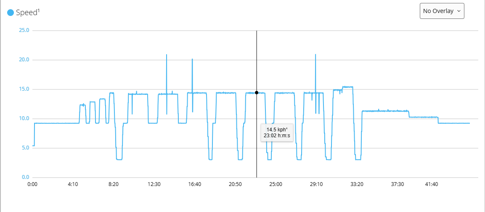

# Garmin Instinct 2 as the display

The sensor is a Bluetooth LE foot pod (Running Speed and Cadence service). With
GPS off, the Instinct 2 takes pace and distance from the pod instead of the wrist
accelerometer. Cadence is deliberately not sent (the packet carries 0): it keeps
coming from the HRM 600 chest strap or the watch. Verified 2026-09-28: the Instinct 2
shows pace from the speed field with cadence 0.

## Two ways to get belt speed onto the watch

| | Native foot pod (sections below) | Connect IQ data field |
|---|---|---|
| Watch pace and distance | from the pod | from the HRM 600 / wrist, as before |
| Belt speed in the activity | as the pace itself | as a developer field (chart in Garmin Connect) |
| HRM 600 | must be paired as heart rate only (loses running power and dynamics) | fully paired, nothing lost |
| Cadence | pod sends 0; whether it overrides the strap is untested | untouched |
| Sensor list on the watch | `millarr` paired as Foot Pod | `millarr` **removed** (the field connects itself) |

The data field route was chosen on 2026-09-29 (`LEDGER.md`). It keeps every metric
from the strap and adds the belt speed next to them. The pace shown in Garmin
Connect stays the strap's estimate; the belt speed is the extra curve.

What that looks like for an 8 × 2 min interval session recorded through the data
field (2026-10-13): the watch's pace wanders within each interval, while the
developer field shows the belt's actual speed steps. The brief spikes above
20 km/h in the speed chart are mark-timing glitches at high speed, known and
under investigation.





### Data field setup (ExtraSensor, Connect IQ store)

ExtraSensor (closed source, free) connects to BLE running speed sensors from inside
an activity and records them to FIT. Verified on the Instinct 2 on 2026-09-29.

1. **Sensors & Accessories → `millarr` → Remove.** Not Off: the native stack
   reconnects to a stored pod within a minute of every sensor boot and takes the
   single connection.
2. Install ExtraSensor from the Connect IQ store. Configure it in the **Connect IQ
   app** on the phone (not Garmin Connect), with the watch connected: sensor 1
   Type = Running Speed (BLE), ID field empty, Data Screen = speed or pace,
   Record to FIT on. **Save** and wait for the sync. If the settings do not stick,
   uninstall and reinstall the field; the README calls this a known Garmin bug, and
   it took a reinstall here.
3. Add the field to the Treadmill activity's data screens (Connect IQ Fields →
   ExtraSensor).
4. Open the activity. The field goes `NEW` → `PAIR` → `ON`, then shows speed. The
   sensor's serial line shows the connect and the subscribe about ten seconds
   later, from the watch's usual address.

### Why the advertising order matters

Connect IQ's BLE scanner only reads the primary advertisement, never the scan
response, and it loses the service UUID list when that list is the last element
of the packet (Garmin bug WERETECH-9123). The sensor therefore advertises
`flags, 0x1814, appearance, name` in that order, and prints the bytes on boot:

```
ble: adv payload=02 01 06 03 03 14 18 03 19 41 04 08 09 6d 69 6c 6c 61 72 72
```

## Native foot pod: pairing (once)

1. Power the sensor. The serial line and the diagnostic page show `advertising`.
   Only one phone or watch can be connected at a time, so disconnect nRF Connect
   or any other scanner first.
2. On the watch: hold **MENU** → **Sensors & Accessories** → **Add New** →
   **Foot Pod** (or **Search All**). Keep the watch within a few metres. The sensor
   appears as `millarr`; the status goes Searching → Connected.
3. Open the new sensor's settings: **Speed** = **Indoor** and **Distance** =
   **Indoor** (use the pod only when GPS is off), **Cal. Factor** → **Set Value**
   → **100.0**, and auto-calibration **off**. Older Garmin firmware mis-handled
   Bluetooth pods in "Always" mode; Indoor is the safe choice.
4. The diagnostic page shows `connected · 0.00 m/s` and the serial line
   `ble=conn`. The watch reconnects by itself whenever an activity starts and the
   sensor is advertising.

## Running

- Start the **Treadmill** activity (GPS off). Wait for the foot pod icon before
  pressing start.
- For a comparison with the sensor's own distance, press **Reset log** on the
  diagnostic page (or `POST /api/reset`) at the same moment as the watch start.
- At the end choose **Save**, never **Calibrate & Save**: the latter rescales the
  recorded distance to a number you type and rewrites the calibration factor,
  which hides what the pod actually reported.
- In Garmin Connect, check the cadence source: it should still be the HRM 600.

## What to expect

- The watch shows the belt's revolution speed. A speed change appears on the next
  mark pass (one belt revolution at one mark, a third of one at three marks).
- When the belt stops, the sensor keeps the last speed until the stop timeout
  (3–15 s depending on the profile's longest mark distance) and then sends 0.
- The pod sends no distance: the watch integrates speed itself and applies its
  calibration factor. The sensor's authoritative distance is `distance_m` in
  `/api/status` and the session file.
- While a session file is downloaded from the diagnostic page the main loop is
  busy for 5–20 s; the connection stays up but no measurements are sent
  meanwhile. Download closed sessions after the run.
- `connects` in `/api/status` (and on the Bluetooth card) counts connections since
  boot. If it grows during a run, the link dropped and the watch reconnected.

## HRM 600 and the foot pod compete for pace and distance

The HRM 600 (like HRM-Pro and HRM-Fit) has its own **Pace & Distance** feature: it
estimates treadmill pace from torso motion and sends it to the watch over ANT+. When
it is paired with all features, the watch has two indoor pace sources, and Garmin's
own manual for the Instinct 2 resolves that by telling you to disable the *foot pod*:
"If you previously connected a compatible foot pod ... set the foot pod status to Off,
or remove it from the list of connected sensors" (Instinct 2 Owner's Manual, "Tips for
Recording Running Pace and Distance"). Stryd documents the same conflict from the
pod's side: the HRM's pace and distance take precedence, and the fix is to connect the
HRM "only as a heart rate monitor".

For this project the pod is the pace source, so the HRM 600 must be paired as
**heart rate only**:

1. **Sensors & Accessories** → open the HRM 600 entry → **Remove**.
2. **Add New** → choose **Heart Rate** (or "External Heart Rate"), **not Search All**.
   Search All pairs the strap with running dynamics, running power and Pace &
   Distance; the Heart Rate sensor type pairs it for heart rate alone.
3. Check the strap's entry afterwards: no **HRM Pace & Distance** submenu should be
   present. If one is, and it offers Speed/Distance options, set both to **Off**.

Running power and running dynamics from the strap are lost with this pairing; that
is the trade. Cadence: the HRM 600 still transmits cadence on the heart-rate
profile; whether the pod's cadence 0 overrides it is the open question in
`docs/test-protocol.md`, section 5.

This was the situation in session 24 (2026-09-29): first run with the HRM 600 and
the pod together, per-lap running power present in the activity (so the strap was
paired with full features), and the pod never connected. The bench pairing two
days earlier, with no strap, worked.

## Troubleshooting

Look at the sensor's serial line (or `connects` in `/api/status`) before touching the
firmware. The watch connecting and subscribing is visible there:

```
ble: connect peer=cb:93:e0:78:75:26 itvl=24 timeout=400 mtu=23
ble: subscribe rsc_measurement=1
ble: disconnect peer=cb:93:e0:78:75:26 reason=531 enc=0 bonded=0
```

- **The pod never connects during a treadmill activity while the HRM 600 is worn**,
  and the bench pairing worked: the strap is paired with Pace & Distance. Re-pair it
  as heart rate only (section above). Do this before suspecting the sensor or
  restarting the watch.
- **Add New → Foot Pod says "No sensor found"** while the serial line shows a connect
  and a subscribe: the watch already has `millarr` stored. Add New only lists new
  sensors. Open **Sensors & Accessories** and look at the list instead.
- **The stored `millarr` shows Searching** while the serial line shows connected and
  notifications flowing: the watch's sensor layer is stuck. **Restart the watch.**
  Nothing on the sensor side fixes this; five identical connections were rejected on
  2026-09-28 until the watch was restarted, then it connected on its own.
- **Disconnect reason 531** (0x213) means the watch hung up; it is normal when the
  watch leaves the sensor menu. **enc=0 bonded=0** is also normal: the Instinct 2 does
  not pair with the pod.
- **Pace off by a percent or two** at a known speed: check **Cal. Factor** on the watch;
  a previous Calibrate & Save leaves it below or above 100.0.
- The watch reconnects by itself within about ten seconds of the sensor rebooting.
